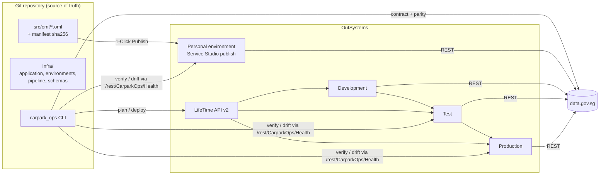

# Singapore Carpark Availability

Real-time availability of HDB carpark lots across Singapore, built on **OutSystems 11 (Reactive Web)** with data
from [data.gov.sg](https://data.gov.sg). This repository holds the application **and everything needed to deploy,
configure, validate and operate it as code**.

Live (personal environment): <https://personal-uzbke9gg.outsystemscloud.com/CarparkAvailability/Dashboard>

| | |
|---|---|
| Module source | [`src/oml/CarparkAvailability.oml`](src/oml/) (+ reviewable text snapshots in [`src/model/`](src/model/)) |
| Infrastructure definition | [`infra/`](infra/): application, per-environment desired state, promotion pipeline, JSON Schemas |
| Automation | [`carpark_ops/`](carpark_ops/): `carpark-ops` CLI (validate, plan, deploy, verify, drift, probe) |
| Tests | [`tests/`](tests/): unit, upstream contract, deployed smoke, browser end-to-end |
| CI/CD | [`.github/workflows/`](.github/workflows/): CI, LifeTime deploy, scheduled monitoring and contract checks |

## Contents

- [How it fits together](#how-it-fits-together)
- [Quick start](#quick-start)
- [Everyday commands](#everyday-commands)
- [Deploying](#deploying)
- [Configuration](#configuration)
- [Testing](#testing)
- [CI/CD](#cicd)
- [Repository layout](#repository-layout)
- [Further documentation](#further-documentation)

## How it fits together



OutSystems is a managed PaaS: servers, databases and networking are provisioned by OutSystems, so "infrastructure
as code" here means the parts you **do** control, all declared in Git and checked automatically:

1. **The application artifact**: the `.oml` module, pinned by SHA-256 in `src/module.manifest.json`, with
   text snapshots of its data model, logic, screen and theme for code review.
2. **Environment desired state**: site properties (thresholds, cache, freshness, data-source ids) per environment,
   validated by JSON Schema plus cross-field rules, with secrets referenced from environment variables only.
3. **Promotion**: Development → Test → Production through the LifeTime Deployment API v2, with GitHub
   Environment approvals and a single-flight lock per target.
4. **Verification**: every deployment and a 30-minute schedule check the app's read-only
   `/rest/CarparkOps/Health` endpoint for freshness, data quality and **configuration drift**, and compare the
   app's carpark count against a reference implementation of the business rules run on the same live data.

> **Constraint worth knowing:** LifeTime API v2 has no site-property operation, and LifeTime does not carry site
> property values between environments. Values are therefore set in Service Center and **verified** as code by
> `carpark-ops drift`, which fails the pipeline when an environment differs from `infra/`.

## Quick start

Prerequisites: Python 3.11+ and Git. Service Studio 11 to change or publish the module. LifeTime credentials
only for Enterprise promotions.

```powershell
git clone https://github.com/shashni/CarparkAvailability.git
cd CarparkAvailability
./scripts/bootstrap.ps1          # Windows: creates .venv and installs the CLI with dev tools
```

```bash
./scripts/bootstrap.sh           # macOS/Linux equivalent
```

Then check that everything is consistent and the live app is healthy:

```bash
carpark-ops validate             # infra/, module package and snapshots
pytest                           # unit tests (offline, ~3 s)
carpark-ops verify --env personal
```

## Everyday commands

| Command | What it does |
|---|---|
| `carpark-ops validate [--strict]` | Schema + semantic validation of `infra/`, `.oml` signature and checksum, snapshot integrity, module ↔ infra consistency |
| `carpark-ops verify --env <env>` | Post-deployment verification: dashboard reachable, health OK, no drift, rules parity with live data |
| `carpark-ops health --env <env> [--refresh] [--json]` | Read the health endpoint |
| `carpark-ops drift --env <env>` | Compare deployed site properties with `infra/environments/<env>.json` |
| `carpark-ops plan --from development --to test [--version 1.4.0]` | Show what a LifeTime promotion would do |
| `carpark-ops deploy --from <env> --to <env> [--version] [--dry-run]` | Promote through LifeTime and wait for the result |
| `carpark-ops probe-source --env <env>` | Check data.gov.sg responses against the contracts the module depends on |
| `carpark-ops update-manifest --exported-from <env>` | Re-pin the module package after exporting a new version |

Exit codes: `0` passed, `1` checks failed, `2` usage or configuration error.

## Deploying

**Enterprise (LifeTime):** run the **Deploy (LifeTime)** workflow (Actions → Deploy → Run workflow), choose
`from`/`to`, and leave *dry run* on for a plan first. Development → Test tags a new version from the modules
running in Development; Test → Production promotes the tagged version and waits for approval. Verification
runs automatically afterwards. Locally: `carpark-ops deploy --from development --to test --version 1.4.0 --notes "..."`.

**Personal environment:** there is no deployment API. Open `src/oml/CarparkAvailability.oml` in Service Studio,
1-Click Publish, then run `carpark-ops verify --env personal` (or the *Monitor environments* workflow).

Full procedure, first-time setup, rollback and module export: [docs/DEPLOYMENT.md](docs/DEPLOYMENT.md).

## Configuration

Site properties are declared once in [`infra/application.json`](infra/application.json) (type, range, default,
description) and given a value per environment in [`infra/environments/`](infra/environments/). Validation
enforces, among others: Low < High threshold, `MinRefreshIntervalSeconds ≤ CacheTtlSeconds`, a stale window
longer than the cache TTL, approval for production, and **no inline secrets**. Details:
[docs/CONFIGURATION.md](docs/CONFIGURATION.md).

| Secret | Where it lives |
|---|---|
| `LIFETIME_URL`, `LIFETIME_TOKEN` | GitHub repository/environment secrets; `.env` locally (git-ignored) |
| `CARPARK_DATAGOV_API_KEY` (optional) | GitHub secret; Service Center site property `DataGovApiKey` |

## Testing

| Suite | Command | Needs | Runs in CI |
|---|---|---|---|
| Unit (106 tests) | `pytest` | nothing (offline) | every push/PR |
| Upstream contract | `pytest -m contract tests/contract` | internet | daily + manual |
| Deployed smoke | `CARPARK_ENV=personal pytest -m smoke tests/smoke` | a deployed env | after every deploy |
| Browser e2e | `pip install -e .[e2e]; playwright install chromium; pytest -m e2e tests/e2e` | Playwright | after every deploy |

What each suite covers is in [docs/TESTING.md](docs/TESTING.md).

## CI/CD

| Workflow | Trigger | Purpose |
|---|---|---|
| `ci.yml` | push, PR | ruff, `carpark-ops validate`, unit tests with coverage |
| `deploy.yml` | manual | plan → (approval) → LifeTime deploy → verify, smoke and browser tests |
| `monitor.yml` | every 30 min, manual | `verify` every enabled environment (health, freshness, drift, parity) |
| `contract.yml` | daily 09:00 SGT, manual | detect breaking changes in data.gov.sg |

One-time GitHub setup (secrets, environments, branch protection): [docs/DEPLOYMENT.md#github-setup](docs/DEPLOYMENT.md#github-setup).

## Repository layout

```
.github/            workflows, dependabot, PR template
carpark_ops/        CLI and libraries (config, lifetime, deploy, health, rules, datagov, model) + contract schemas
docs/               architecture, deployment, configuration, operations runbook, testing
infra/              application.json, environments/*.json, pipeline.json, schemas/
scripts/            bootstrap.ps1, bootstrap.sh
src/oml/            CarparkAvailability.oml (binary, published artifact)
src/model/          text snapshots of the module (data model, logic, screen, theme)
src/module.manifest.json   sha256 pins + element inventory
tests/              unit/, contract/, smoke/, e2e/, fixtures/
```

## Further documentation

- [docs/ARCHITECTURE.md](docs/ARCHITECTURE.md): application design, data rules, decisions and trade-offs
- [docs/DEPLOYMENT.md](docs/DEPLOYMENT.md): environments, first-time setup, releases, rollback, exporting the module
- [docs/CONFIGURATION.md](docs/CONFIGURATION.md): every site property, validation rules, secrets
- [docs/OPERATIONS.md](docs/OPERATIONS.md): runbook for alerts and incidents
- [docs/TESTING.md](docs/TESTING.md): test strategy and coverage
- [CHANGELOG.md](CHANGELOG.md)
