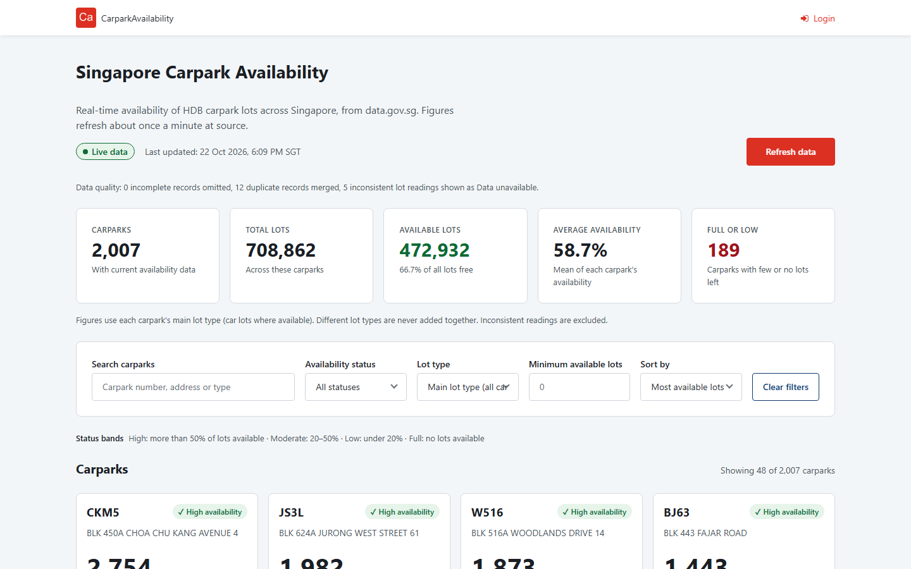
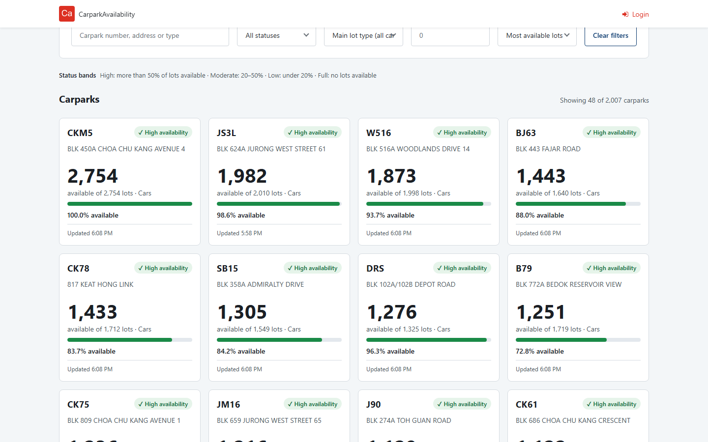
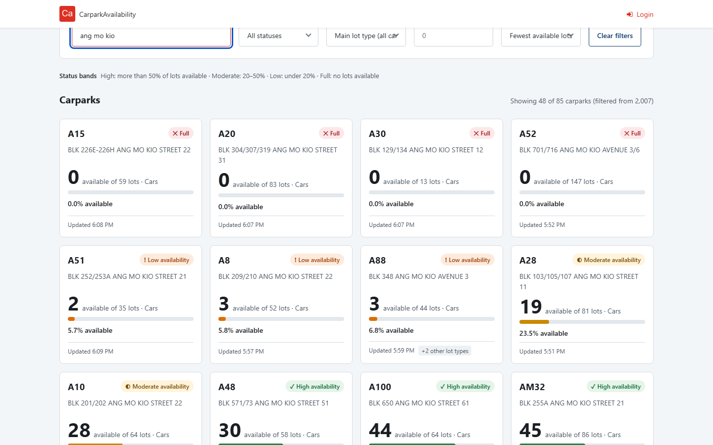
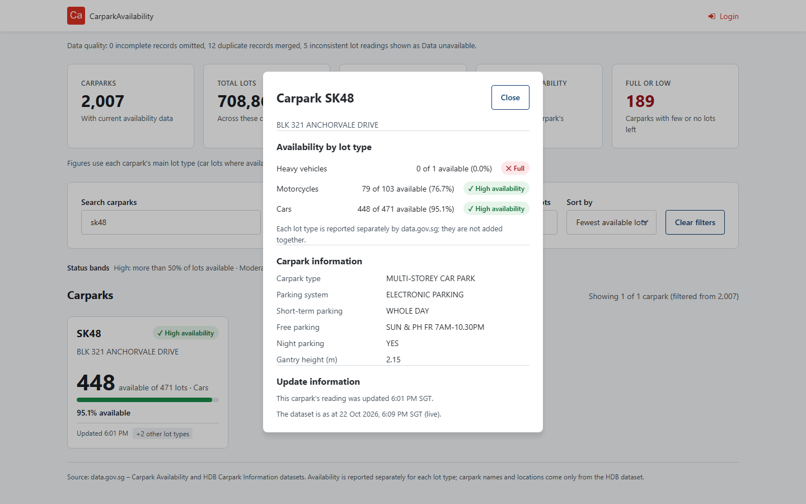
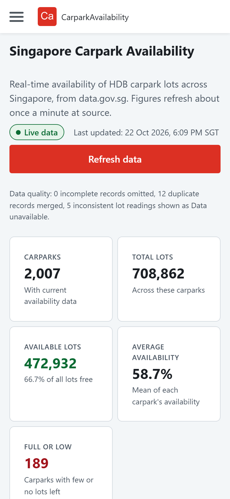
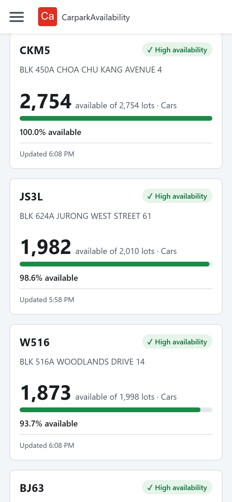
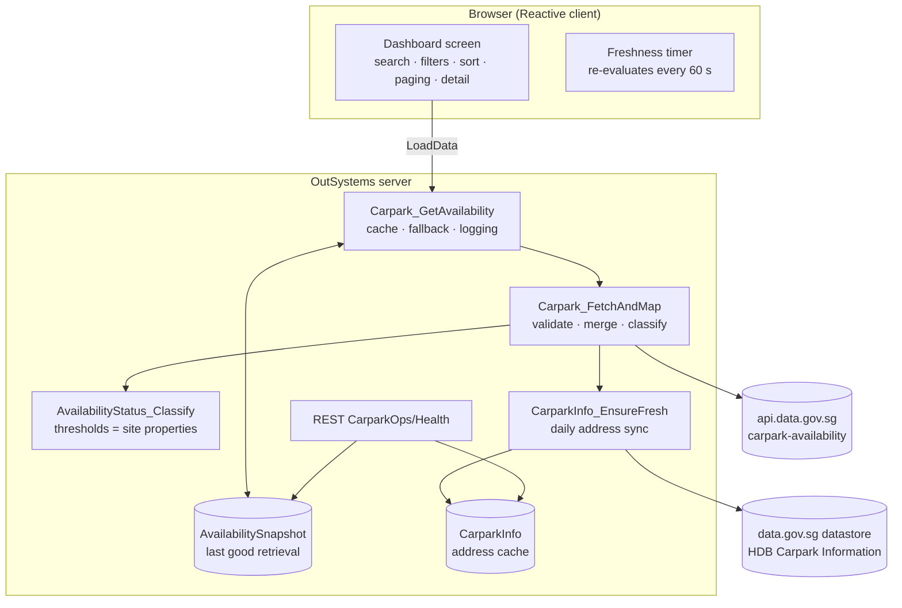
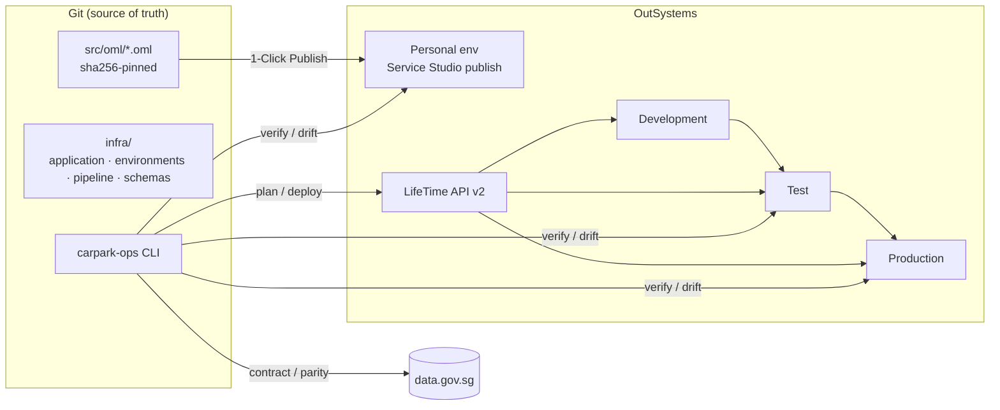

# Singapore Carpark Availability

Real-time availability of HDB carpark lots across Singapore, built on **OutSystems 11 (Reactive Web)** with open
data from [data.gov.sg](https://data.gov.sg). The repository holds the application and everything needed to
deploy, configure, validate and operate it as code.

### 🔗 Live application

**<https://personal-uzbke9gg.outsystemscloud.com/CarparkAvailability/Dashboard>**

Operational health endpoint (read-only JSON):
<https://personal-uzbke9gg.outsystemscloud.com/CarparkAvailability/rest/CarparkOps/Health>

| At a glance | |
|---|---|
| Platform | OutSystems 11, Reactive Web, OutSystems UI |
| Data sources | data.gov.sg *Carpark Availability* (refreshed about every minute) and *HDB Carpark Information* (addresses) |
| Scale | about 2,000 carparks and 2,400 lot-type readings per refresh, about 2,270 address records |
| Verified | 106 offline unit tests, 4 live contract tests, 6 deployed smoke tests, 5 browser end-to-end tests; dashboard figures match an independent recomputation from the live API exactly |
| Delivery | `infra/` desired state + `carpark-ops` CLI + GitHub Actions (CI, LifeTime deploy, 30-min monitor, daily contract check) |

---

## Contents

1. [Screenshots](#1-screenshots)
2. [What the application does](#2-what-the-application-does)
3. [Architecture](#3-architecture)
4. [Key technical decisions and their reasoning](#4-key-technical-decisions-and-their-reasoning)
5. [Data integrity rules](#5-data-integrity-rules)
6. [Engineering practices](#6-engineering-practices)
7. [Quality evidence: testing and verification](#7-quality-evidence-testing-and-verification)
8. [Infrastructure as code and delivery](#8-infrastructure-as-code-and-delivery)
9. [Assumptions](#9-assumptions)
10. [Limitations and known issues](#10-limitations-and-known-issues)
11. [Trade-offs at a glance](#11-trade-offs-at-a-glance)
12. [How the solution was built](#12-how-the-solution-was-built)
13. [Getting started](#13-getting-started)
14. [Repository layout and further documentation](#14-repository-layout-and-further-documentation)

---

## 1. Screenshots

All screenshots are of the live deployment and are reproducible with
[`scripts/capture_screenshots.py`](scripts/capture_screenshots.py), so the README can be refreshed whenever the UI
changes.

**Dashboard (desktop):** header with freshness state and last successful update, data-quality note, summary
metrics, filters, status legend and results.



**Results grid:** the available-lot count is the most prominent figure on each card. The status is conveyed by
icon, text and colour together, never by colour alone.



**Search and filters:** address search ("ang mo kio") with the *Fewest available lots* sort. 85 of 2,007
carparks match and the count updates instantly.



**Detail view:** carpark SK48, whose lot types data.gov.sg delivers in two separate records, merged into one
carpark with a per-lot-type breakdown, HDB carpark information and update metadata.



**Mobile (390 px):** content stacks in one column; the Refresh button becomes full width; the available-lot count
stays the dominant figure.

<p>
  
  &nbsp;&nbsp;
  
</p>

---

## 2. What the application does

| Requirement | How it is met |
|---|---|
| Page title, subtitle, last-updated time | Header shows the title, a one-line context, a **Live / Stale / Not refreshed / Unavailable** label and *Last updated: 22 Oct 2026, 6:09 PM SGT (n minutes ago)* |
| Availability overview | Five metrics: carparks, total lots, available lots (with % free), average availability, full-or-low count |
| Per-carpark metrics | Carpark number, address, available lots (largest figure), total lots, % available, status badge, lot type, update time |
| Clear status thresholds | High > 50 %, Moderate 20–50 %, Low < 20 %, Full = 0, plus *Data unavailable* for inconsistent readings. Thresholds are **site properties**, shown in a legend |
| Search | Carpark number, address or carpark type (case-insensitive) |
| Filters | Status, lot type (cars, motorcycles, heavy vehicles, motorcycles with side car), minimum available lots, Clear filters |
| Sorting | Most / fewest available, highest availability %, highest occupancy %, carpark number A–Z, most recently updated |
| Refresh | Prominent button with loading, success and error states; duplicate requests are blocked while one is running |
| Results summary | "Showing 48 of 85 carparks (filtered from 2,007)", announced to screen readers |
| Detail view | Per-lot-type breakdown, HDB carpark information (type, parking system, free/night parking, gantry height), reading and dataset times, outdated-reading warning |
| Data states | Loading skeletons, empty results, stale, cached (last good data), partial (data-quality note), unavailable, failed refresh |

---

## 3. Architecture



The layers are kept apart deliberately:

| Layer | Elements | Responsibility |
|---|---|---|
| External integration | `DataGovSG_Transport`, `DataGovSG_Datastore` (consumed REST, own DTO structures) | Transport only; raw shapes never leave the mapping action |
| Validation and mapping | `Carpark_FetchAndMap` → `CarparkLotRow` structure | Turns untrusted upstream JSON into application records |
| Business rules | `AvailabilityStatus_Classify`, primary-lot and merge rules | Single place for thresholds and status logic |
| Caching and resilience | `Carpark_GetAvailability`, `AvailabilitySnapshot` | Rate protection, last-good fallback, freshness metadata |
| Presentation | `Dashboard` screen, theme CSS | Filtering, sorting, paging, accessibility; no knowledge of data.gov.sg formats |
| Operations | `CarparkOps/Health`, `carpark_ops` CLI | Monitoring, drift detection, deployment verification |

More detail: [docs/ARCHITECTURE.md](docs/ARCHITECTURE.md).

---

## 4. Key technical decisions and their reasoning

Each decision below records the context, the choice, the alternatives considered and the consequences, so
reviewers can judge the reasoning, not just the result.

### D1. Validate and map on the server, never bind the UI to the API shape
- **Context:** data.gov.sg returns counts as strings, splits some carparks across records, and contains readings with
  `total_lots = 0` or more available than total.
- **Decision:** a dedicated mapping action converts the response into the `CarparkLotRow` structure, validating each
  lot type independently.
- **Alternatives:** binding the UI to the REST output (fast to build, but every upstream quirk becomes a UI bug).
- **Consequence:** the UI depends only on application structures; upstream changes are contained in one action and
  caught by the daily contract test.

### D2. Short server-side cache with last-good fallback
- **Context:** the dataset changes about once a minute; every user calling the API directly would multiply upstream
  load and fail as soon as data.gov.sg is down.
- **Decision:** reuse a successful retrieval for 60 s (15 s when a user forces Refresh). On failure, serve the last
  good snapshot **labelled as cached**, with a plain-language message.
- **Alternatives:** no cache (simple, fragile); a scheduled timer pre-fetching every minute (always warm, but it
  fetches even when nobody is looking, and timers are another moving part on a personal environment).
- **Consequence:** one upstream call per minute regardless of traffic; outages degrade to clearly labelled cached
  data instead of an error page.

### D3. Freshness is measured from the source, and the label is never stale itself
- **Context:** "never present stale data as live". The server clock may not be in SGT, and a page left open keeps
  ageing.
- **Decision:** data age is computed from the API's reading timestamp against the API's own HTTP `Date` header (so
  no server-timezone assumption), and a client timer re-evaluates the label every minute. *Last updated* changes
  only after a successful retrieval.
- **Alternatives:** using the server's clock (wrong whenever the server isn't in SGT); evaluating freshness only at
  load time (the page silently goes stale).
- **Consequence:** the Live/Stale/Cached label is trustworthy even on a tab left open for an hour.

### D4. Times are formatted as SGT text on the server
- **Context:** Reactive apps convert `DateTime` values to the browser's timezone, but data.gov.sg times are SGT
  wall-clock values without an offset.
- **Decision:** the server sends display text (e.g. "6:09 PM"), and keeps `DateTime` values only for sorting.
- **Consequence:** a visitor whose device is in another timezone still sees correct Singapore times.

### D5. Per-lot-type availability, never summed across vehicle types
- **Context:** about 10 % of carparks report several lot types; adding motorcycle lots to car lots would produce a
  meaningless figure.
- **Decision:** every percentage and status is per lot type. Each carpark has one main lot type (valid car lots
  when present). Summary metrics use the main lot type, or only the lot type selected in the filter, as stated
  under the metrics.
- **Consequence:** figures are comparable and honest; the detail view shows the full breakdown.

### D6. Thresholds and operational limits as site properties
- **Context:** thresholds must be changeable without editing UI components.
- **Decision:** `HighAvailabilityMinPct`, `LowAvailabilityMaxPct`, freshness and cache limits are site properties,
  read in exactly one action (`AvailabilityStatus_Classify`) and displayed in the legend.
- **Consequence:** operations can tune them per environment in Service Center; `infra/` declares the desired values
  and `carpark-ops drift` proves each environment matches.

### D7. Load once, filter and sort in the browser
- **Context:** about 2,000 carparks; filters should respond on every keystroke.
- **Decision:** the server returns all rows once (cached), and the client filters, summarises and sorts in a single
  pass, rendering 48 cards at a time with *Show more*.
- **Alternatives:** server-side filtering (a round trip per keystroke, more server load).
- **Consequence:** instant interaction at the cost of about 1 MB per page load, which is acceptable for this data size.

### D8. Verify site properties, rather than deploy them
- **Context:** LifeTime API v2 has no site-property operation, and LifeTime doesn't carry values between
  environments.
- **Decision:** add a read-only `CarparkOps/Health` endpoint that reports the effective non-secret configuration,
  and treat any difference from `infra/` as a failing check.
- **Alternatives:** scripted Service Center UI automation (brittle); trusting manual configuration (unverifiable).
- **Consequence:** configuration is declared and verified in code; applying a changed value remains a documented
  manual step.

### D9. A reference implementation of the business rules
- **Context:** low-code flows can't be unit-tested from a Git repository.
- **Decision:** [`carpark_ops/rules.py`](carpark_ops/rules.py) restates the rules in Python. Unit tests pin them,
  and verification compares the live app's counters with them on the same live payload.
- **Consequence:** this caught two real defects before release (see section 7).

### D10. Public, read-only, no personal data
- **Decision:** the dashboard and health endpoint are anonymous: the data is public and nothing is written by
  users. The API key is a secret site property, sent only when set, masked in logs, and reported by the health
  endpoint only as configured / not configured.

---

## 5. Data integrity rules

| Situation in the source data | Behaviour | Why |
|---|---|---|
| Record without carpark number or lot data | Rejected and counted | Can't be attributed to a carpark |
| Same carpark split across records (10–14 per refresh) | Merged into one carpark | The records carry *different* lot types, so neither is a stale duplicate |
| Non-numeric counts | That lot type is skipped and counted | Never guess a number |
| `total_lots = 0`, or more available than total | Kept, shown as **Data unavailable**, excluded from totals and averages | Showing the carpark is more honest than hiding it; using the number would be fabricating |
| Reading much older than the dataset (e.g. months) | Flagged "Reading not recently updated" | The figure may no longer be true |
| Address missing from the HDB dataset | "Address not available" | Names and locations come only from the official dataset |
| Upstream unavailable | Last good data labelled *Not refreshed*, or *Unavailable* when none exists | Never present cached data as live |

Each counter is visible on the dashboard's data-quality note and in the health endpoint.

---

## 6. Engineering practices

| Practice | How it is applied | Evidence |
|---|---|---|
| Separation of concerns | Integration, mapping, rules, caching, presentation and operations are separate elements | [Section 3](#3-architecture), `src/model/` |
| Single source of truth | Thresholds in site properties; status labels in a static entity; rules in one action | `infra/application.json`, `AvailabilityStatus_Classify` |
| Everything as code | Module package pinned by SHA-256, environment desired state, pipeline, workflows | `src/module.manifest.json`, `infra/`, `.github/` |
| Reviewable low-code | Model API text snapshots of the data model, logic, screen and theme committed beside the binary `.oml` | `src/model/*.cs` |
| Shift-left validation | JSON Schema plus cross-field rules (Low < High, stale window > cache TTL, no inline secrets, production needs approval) | `carpark-ops validate`, `tests/unit/test_config.py` |
| Contract testing | Upstream response contracts checked daily; health endpoint contract checked after each deploy | `carpark_ops/schemas/`, `contract.yml` |
| Verification after deployment | Health, freshness, configuration drift and rules parity on every deploy and every 30 minutes | `carpark-ops verify`, `monitor.yml` |
| Fail safe, fail visible | Last-good fallback, plain user messages, technical detail logged under `CarparkIntegration` | Server logic, [docs/OPERATIONS.md](docs/OPERATIONS.md) |
| Secure CI | Read-only `contents` permission, version-pinned actions, inputs never interpolated into shell, approval-gated production, a single deployment per target at a time | `tests/unit/test_workflows.py` |
| Accessibility (WCAG 2.2 AA intent) | Semantic headings, labelled inputs, keyboard-operable cards and popup, visible 3 px focus ring, live regions for counts and status, status by icon and text as well as colour, AA contrast tokens, reduced-motion and forced-colours support, 44 px touch targets | Theme CSS, `tests/e2e/` |
| Performance | One upstream call per minute, one-pass client filtering, paging of rendered cards, snapshot stored as a single row | [D2](#d2-short-server-side-cache-with-last-good-fallback), [D7](#d7-load-once-filter-and-sort-in-the-browser) |
| Observability | Health endpoint, structured log lines per refresh (counts, rejects, merges, data age) | `CarparkOps/Health` |
| Documentation as a deliverable | Architecture, deployment, configuration, runbook, testing, changelog, decision records | `docs/`, this README |

---

## 7. Quality evidence: testing and verification

| Suite | Count | What it proves |
|---|---|---|
| Unit (offline, about 3 s) | 106 | Business rules at every boundary (from a real trimmed payload and hand-written edge cases), configuration rules, LifeTime client and deployment logic, module-package integrity, workflow security |
| Contract (live data.gov.sg) | 4 | Upstream responses still match what the module's structures expect, and the data is current |
| Smoke (live deployment) | 6 | Correct module served, health OK, no drift, rules parity, no secrets exposed |
| End-to-end (Playwright) | 5 | Live data loads; summary matches health; default sort order; search and keyboard-opened detail; single-flight refresh; no horizontal scroll at 375 px |
| `carpark-ops verify` | 4 checks | Dashboard reachable · health OK · drift none · parity 2,007 vs 2,007 |

**Independent cross-check:** at the same API minute, the dashboard showed 2,007 carparks, 708,842 lots, 488,937
available, 60.9 % average and 192 full-or-low. A separate Python recomputation from the raw API response gave
identical numbers.

**Defects found by verification and fixed before release:**

| Defect | Found by | Root cause | Fix |
|---|---|---|---|
| Carparks counted twice | Comparing dashboard totals with the API | data.gov.sg splits some carparks' lot types across records | Merge split records by carpark number |
| Sorting had no effect; detail view empty | Browser testing | System `ListSort`/`ListFilter` created via the Model API compile against `List.Current`, not the compared element | Sort in a JavaScript node; filter with a loop |
| First load failed on a cold start | Browser network log | Address sync exceeded the 10 s client default | Server-call timeout raised to 60 s |
| Empty first column in the card grid on wide screens | Visual review at 1440 px | A hidden `<script>` element inside the list occupied a grid cell | Theme rule hides it |
| Shell injection risk in the deploy workflow | Code review | Free-text input interpolated into `run:` | Inputs passed via environment variables, enforced by a test |

---

## 8. Infrastructure as code and delivery

OutSystems is a managed PaaS: servers, databases and networking belong to OutSystems. Infrastructure as code
therefore covers what this team controls:



| Workflow | Trigger | Purpose |
|---|---|---|
| `ci.yml` | push, PR | ruff, `carpark-ops validate`, unit tests with coverage |
| `deploy.yml` | manual | plan → GitHub Environment approval → LifeTime deploy → verify, smoke and browser tests |
| `monitor.yml` | every 30 min | verify every enabled environment |
| `contract.yml` | daily 09:00 SGT | detect breaking upstream changes |

Main commands: `carpark-ops validate`, `plan`, `deploy`, `verify`, `health`, `drift`, `probe-source`,
`update-manifest`. Exit codes: 0 passed, 1 checks failed, 2 usage error. Full procedures:
[docs/DEPLOYMENT.md](docs/DEPLOYMENT.md), [docs/CONFIGURATION.md](docs/CONFIGURATION.md),
[docs/OPERATIONS.md](docs/OPERATIONS.md).

---

## 9. Assumptions

- **Audience and access:** the dashboard is public and anonymous; the data is open government data and users
  write nothing.
- **Status thresholds:** no existing convention was found in the application or data source, so the brief's
  suggested bands are used (High > 50 %, Moderate 20–50 % inclusive, Low < 20 %, Full = 0). They are configurable.
- **Main lot type:** car lots represent a carpark by default because they are the most common need; other lot
  types remain one filter away.
- **Location data:** names and locations come only from the official *HDB Carpark Information* dataset. Carparks
  missing from it (a few non-HDB ones) are shown by number, and nothing is inferred.
- **Freshness:** data older than 15 minutes is considered stale; individual readings more than 60 minutes behind
  the dataset are flagged.
- **API key:** the anonymous data.gov.sg tier is sufficient at one call per minute; an API key can be added through
  a secret site property without code changes.
- **Enterprise environments:** the LifeTime pipeline assumes Development, Test and Production environments with a
  service account. These ship disabled until their hosts are filled in.

---

## 10. Limitations and known issues

| Limitation | Impact | Mitigation / next step |
|---|---|---|
| No map view | Coordinates (SVY21) are cached but not plotted | OutSystems Maps is already referenced; a map needs an SVY21 → WGS84 conversion |
| LifeTime pipeline not exercised against a real LifeTime | Client and orchestration are covered by unit tests against the documented API contract, but not by a live run | Enable an Enterprise environment and run `deploy.yml` in dry-run mode first |
| Site properties are applied manually in Service Center | A missed value would be wrong until noticed | `drift` fails CI after every deploy and every 30 min |
| Dashboard is not the application's default screen yet | The root URL doesn't open it (the `/Dashboard` URL does) | One click in Service Studio; can't be set through the Model API |
| Template "Login" link remains in the header | Unnecessary for a public app | Remove the user-info block from the layout |
| Lot-type dropdown default text is truncated at desktop width ("Main lot type (all ca…") | Cosmetic | Shorten the label or widen the column |
| For merged carparks, the detail view shows the first record's update time | The two records may differ by a minute | Show per-lot-type times in the breakdown |
| About 1 MB payload per page load | Slower on poor mobile connections | Acceptable for 2,000 rows; server-side paging if the dataset grows substantially |
| First load after 24 h is about 5 s slower | It runs the address sync | A scheduled timer could warm it; not used to keep the personal environment simple |
| Health endpoint is unauthenticated | The effective non-secret configuration is public | By design (no personal data, no secret values); can be put behind Basic auth if required |
| Text snapshots are exported through Service Studio's MCP tools | Refreshing them needs that tooling | The binary `.oml` remains authoritative; `validate` detects stale manifests |

---

## 11. Trade-offs at a glance

| Chose | Over | Because |
|---|---|---|
| Server cache + last-good fallback | Direct API calls per user | Upstream protection and graceful degradation |
| Client-side filtering | Server-side filtering | Instant feedback at this data size |
| Snapshot stored as one JSON row | Relational snapshot tables | 1 write instead of about 2,400 per refresh; relational queries aren't needed |
| Lazy daily address sync | Timer | Fewer moving parts; cost is one slower load per day |
| Site properties verified as code | Pushed through an API | No such API exists; verification still fails fast |
| JavaScript sort node | System `ListSort` | The Model API–generated `ListSort` silently doesn't sort |
| Public health endpoint | Authenticated monitoring | Simpler CI and monitoring; no sensitive content |
| Python reference rules | Testing only through the UI | Fast, deterministic, and it catches low-code regressions |

---

## 12. How the solution was built

The module was built programmatically: Model API C# applied through Service Studio's MCP tools, merged into the
module, and published. Each step was tried as a no-save run first, so validation errors surfaced before anything
was saved. After every publish, the result was checked in a real browser and against the live API, not just
against OutSystems validation. That loop is why the defects in [section 7](#7-quality-evidence-testing-and-verification)
were found before release: the platform reported no errors for any of them.

The infrastructure layer then turned those manual checks into repeatable ones: the same health, drift and parity
checks run from the CLI, in CI after every deployment, and on a schedule.

---

## 13. Getting started

Prerequisites: Python 3.11+, Git. Service Studio 11 to change or publish the module; LifeTime credentials only
for Enterprise promotions.

```powershell
./scripts/bootstrap.ps1        # Windows (bootstrap.sh on macOS/Linux): .venv + CLI + dev tools
carpark-ops validate           # infra/, module package, snapshots
pytest                         # 106 unit tests, offline
carpark-ops verify --env personal
```

Optional live suites:

```bash
pytest -m contract tests/contract
CARPARK_ENV=personal pytest -m smoke tests/smoke
pip install -e .[e2e] && playwright install chromium && CARPARK_ENV=personal pytest -m e2e tests/e2e
python scripts/capture_screenshots.py      # refresh docs/images/
```

**Publishing the personal environment:** open `src/oml/CarparkAvailability.oml` in Service Studio,
1-Click Publish, then `carpark-ops verify --env personal`.
**Enterprise:** Actions → *Deploy (LifeTime)* → choose source and target, dry run first.
Setup steps: [docs/DEPLOYMENT.md](docs/DEPLOYMENT.md#github-setup).

---

## 14. Repository layout and further documentation

```
.github/                    CI, deploy, monitor and contract workflows; dependabot; PR template
carpark_ops/                CLI and libraries: config, lifetime, deploy, health, rules, datagov, model; contract schemas
docs/                       ARCHITECTURE, DEPLOYMENT, CONFIGURATION, OPERATIONS (runbook), TESTING; images/
infra/                      application.json, environments/*.json, pipeline.json, schemas/
scripts/                    bootstrap.ps1, bootstrap.sh, capture_screenshots.py
src/oml/                    CarparkAvailability.oml (binary, published artifact)
src/model/                  Model API text snapshots of the module (reviewable)
src/module.manifest.json    sha256 pins and element inventory
tests/                      unit/, contract/, smoke/, e2e/, fixtures/
```

| Document | For |
|---|---|
| [docs/ARCHITECTURE.md](docs/ARCHITECTURE.md) | Design, data flow, freshness model, security |
| [docs/DEPLOYMENT.md](docs/DEPLOYMENT.md) | Environments, GitHub setup, releases, rollback, exporting the module |
| [docs/CONFIGURATION.md](docs/CONFIGURATION.md) | Every site property, validation rules, secrets |
| [docs/OPERATIONS.md](docs/OPERATIONS.md) | Runbook: alerts, diagnosis, routine tasks |
| [docs/TESTING.md](docs/TESTING.md) | Test strategy and per-file coverage |
| [CHANGELOG.md](CHANGELOG.md) | Release history |
