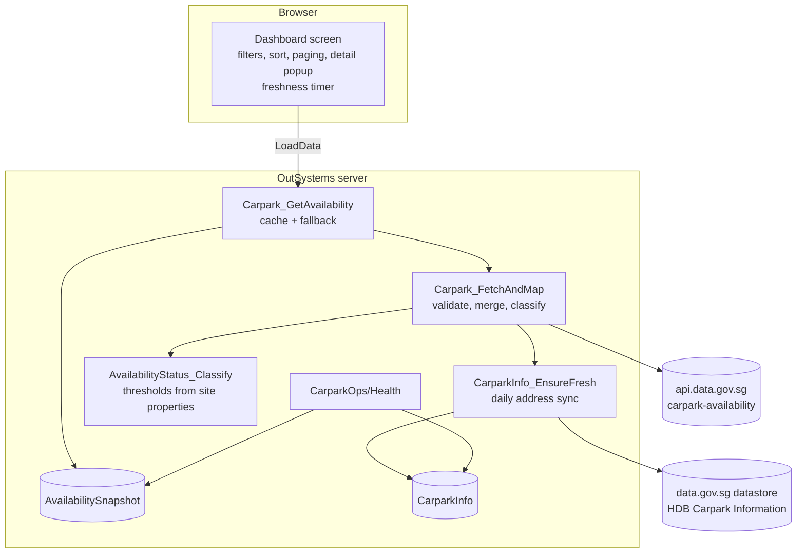

# Architecture

## Application

One OutSystems 11 Reactive Web module, `CarparkAvailability`, with one public screen (`MainFlow/Dashboard`) and one
read-only REST API (`CarparkOps/Health`).

### Data flow

1. The screen's `OnReady` calls `LoadData`, which calls `Carpark_GetAvailability` (60 s client timeout, so the
   first-ever load can include the address sync).
2. `Carpark_GetAvailability` reuses the stored snapshot when it is younger than `CacheTtlSeconds`
   (`MinRefreshIntervalSeconds` when the user forces a refresh). Otherwise it calls `Carpark_FetchAndMap`, stores
   the validated rows as one JSON snapshot row, and returns them labelled **Live**.
3. If the upstream call or validation fails, the last good snapshot is returned labelled **Cached** with a
   user-safe message; with no snapshot the result is **Unavailable**. The technical error goes to the module log
   (`CarparkIntegration`), never to the user.
4. The browser filters, summarises, sorts and pages the rows locally. A JavaScript timer re-evaluates the
   freshness label every minute, so data cannot silently age into looking live.

### Data rules (pinned by `carpark_ops/rules.py` and its tests)

| Rule | Behaviour |
|---|---|
| Incomplete record (no number or no lot data) | rejected, counted in `rejectedCount` |
| Same carpark split across records (data.gov.sg does this for about 1% of carparks) | merged into one carpark, counted in `mergedRecordCount` |
| Non-numeric lot counts | that lot type is skipped, counted as inconsistent |
| Total ≤ 0, or more available than total | kept, shown as "Data unavailable", excluded from totals and averages |
| Status | Full at 0; Low below `LowAvailabilityMaxPct`; High above `HighAvailabilityMinPct`; Moderate otherwise (both thresholds inclusive) |
| Main lot type | valid car lots when present, otherwise the first lot type received |
| Summary metrics | one lot per carpark (main lot type, or the chosen lot type); lot types are never added together |
| Times | data.gov.sg times are SGT wall-clock; the server formats them as text so the browser timezone cannot shift them |

### Freshness states

| State | Meaning |
|---|---|
| Live | data age (from the upstream reading time) ≤ `StaleAfterMinutes` |
| Stale | older than `StaleAfterMinutes` |
| Not refreshed (Cached) | the server fell back to the last good data, or this page's last refresh failed |
| Unavailable | no data has ever been retrieved |

"Last updated" only changes after a successful retrieval.

## Decisions and trade-offs

| Decision | Why | Trade-off |
|---|---|---|
| Snapshot stored as one JSON row | about 2,400 rows per minute would otherwise cost about 2,400 inserts | the snapshot can't be queried relationally (not needed) |
| Filtering/sorting in the browser | 2,000 rows filter in milliseconds; no server round trip per keystroke | about 1 MB payload per load (cached by the server for 60 s) |
| Sorting in a JavaScript node, not System `ListSort` | `ListSort`/`ListFilter` created through the Model API compile their condition against `List.Current` and silently do nothing (found in browser testing) | one small JS node to maintain |
| Health endpoint without authentication | monitoring and CI need it; it exposes no personal data and no secret values (API key reported only as configured / not) | the effective non-secret configuration is public |
| Site properties verified, not pushed | LifeTime API v2 has no site-property operation | values are set once per environment in Service Center; `drift` catches mistakes |
| Address cache refreshed lazily (on first load after 24 h) | no timer to schedule or monitor | that first load is slower (about 5 s) |

## Security

- The dashboard and health endpoint are public by design: public, read-only government open data.
- Secrets (`DataGovApiKey`, LifeTime token) never live in the repository: `infra/` references environment
  variables, and validation fails if a secret is written inline.
- The REST consumers send the API key only when it is set (`DontSend` default behaviour) and mark it sensitive
  so it is masked in integration logs.
- CI workflows use read-only `contents` permission, pin action versions, and pass workflow inputs to shell steps
  only through environment variables (enforced by `tests/unit/test_workflows.py`).
